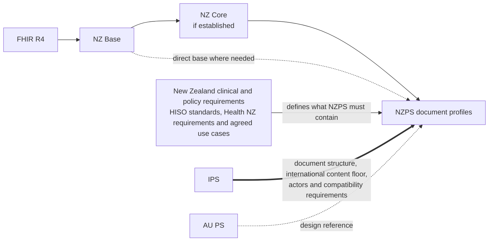
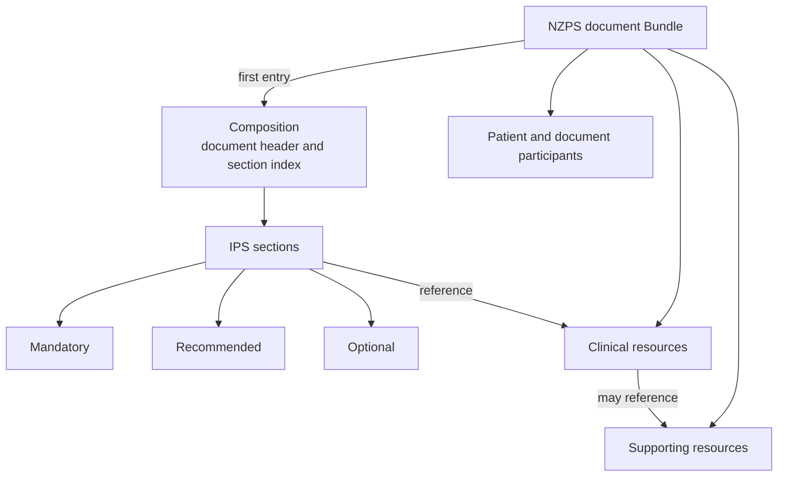

# NZPS rework plan

## Intended outcome

The reworked New Zealand Patient Summary (NZPS) will be a New Zealand localisation of the International Patient Summary (IPS), not a separate document model. It will follow the architectural pattern demonstrated by the Australian Patient Summary (AU PS): retain full IPS conformance while adding national requirements through New Zealand profiles, identifiers, terminology and implementation guidance.

The key conformance promise will be:

> Every valid NZPS document is also a valid IPS document. An IPS document is not necessarily a valid NZPS document because it may not meet the additional New Zealand requirements.

AU PS is a design reference for this work, rather than a dependency or a source of Australian requirements to copy unchanged.

## Standards architecture

NZPS will separate clinical requirements, national FHIR foundations and patient-summary conformance.

*Figure 1: NZPS will build on the New Zealand FHIR layer while conforming independently to IPS.*

NZPS profiles will derive from the appropriate NZ Base or NZ Core profiles where these exist. If a suitable NZ Core layer is not available, the profiles may derive directly from NZ Base, while keeping the distinction between reusable national constraints and NZPS-only document constraints clear.

For every NZPS profile with an IPS counterpart, the profile will formally declare that it complies with that IPS profile. This allows NZPS to inherit New Zealand requirements without requiring IPS profiles to be its direct base. Profiles added solely for New Zealand use cases will not make an IPS compatibility claim where no IPS counterpart exists.

## Document model

The IPS document skeleton will be preserved:

*Figure 2: The NZPS document remains an IPS-style FHIR document Bundle.*

The rework will retain the IPS sections, their cardinalities and the rule that each mandatory section contains either entries or an explanation of why it is empty. Composition participants and section entries will be retargeted to NZPS profiles, and the Bundle will continue to carry the complete, resolvable document content. Additional profiles may be included where justified by New Zealand use cases, such as care encounters or whānau and support-person relationships, without removing IPS sections or narrowing what IPS permits.

## New Zealand localisation

National requirements will be added as constraints on top of the IPS-compatible model. These will cover, at a high level:

- New Zealand patient, practitioner, organisation and facility identifiers;
- New Zealand medicines, immunisation, clinical and laboratory terminology;
- nationally required demographic, language, ethnicity and other equity-related information;
- New Zealand reference targets and extensions supplied by NZ Base or NZ Core; and
- any additional resources needed by agreed NZPS clinical use cases.

Existing national and international artefacts will be reused wherever suitable. Minimum cardinalities will be strengthened only where there is a clear New Zealand requirement. Maximum cardinalities will not be tightened and IPS-permitted content will not be removed, preserving graceful handling by IPS-aware systems.

## Conformance and implementation guidance

NZPS will define Producer and Consumer actors based on the IPS Creator and Consumer. Must Support elements will have explicit obligations: producers will know when data must be populated or supported when known, and consumers will be required to handle it and, where appropriate, display it. Guidance will cover primitives, repeating elements, references, identifiers and multiple codings consistently.

The IG will also distinguish the main absence cases: omitted optional data, unavailable mandatory data, empty sections, an affirmative statement that there is no known information, and information suppressed for privacy or legal reasons. Examples will demonstrate these cases as well as generated and curated summaries.

The initial scope will remain a document content and conformance specification. Transport, repository access and API interactions will be left to suitable IPS, IPA or New Zealand exchange specifications rather than being embedded in the NZPS document profiles.

## Assurance and publication

The compatibility claim will be tested, not only stated. NZPS examples will be validated against both NZPS and IPS, and paired profiles will be compared in both directions at the mandatory and recommended requirement levels. The IG will publish a variance statement explaining the additional New Zealand requirements, demonstrating that NZPS introduces no variance from IPS, and documenting the reverse-direction caveat for consuming a plain IPS document.
